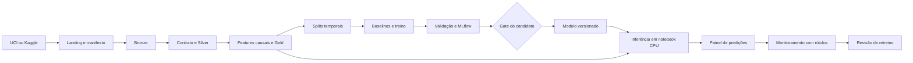

# 07 — Pipeline de machine learning de ponta a ponta

**Estado demonstrado:** Planejado · standby. Evidências de 28/10/2026 quando aplicável.

Este documento preserva requisitos e design do estudo. Etapas futuras, quantidades planejadas e critérios de aceite não comprovam execução. Consulte o estudo de caso para escopo, resultados e limites atuais.

**Estado:** somente planejamento. **Competência:** transformar uma fonte pública em predições versionadas, consumíveis e monitoradas. **Domínio:** demanda horária de bicicletas; independente dos dados fictícios das bibliotecas. Nenhum dataset foi baixado, modelo treinado ou endpoint criado.

## Problema, decisão de uso e requisitos

Estimar a demanda de uma próxima janela horária para apoiar um painel de planejamento operacional. O objetivo do portfólio é demonstrar todo o ciclo, incluindo um resultado que eventualmente não supere a referência.

| ID | Requisito | Evidência de aceite futuro |
| --- | --- | --- |
| RF01 | Adquirir fonte com proveniência | Arquivos, licença, versão/identificador e hashes |
| RF02 | Ingerir e limpar com contratos | Bronze/Silver reconciliadas e rejeitados explicados |
| RF03 | Criar features sem usar o futuro | Cada feature tem availability_time compatível com a decisão |
| RF04 | Separar treino, validação e teste no tempo | Fronteiras e IDs congelados antes do ajuste |
| RF05 | Comparar baselines e modelos | Mesmos splits, métricas e orçamento de tuning |
| RF06 | Registrar candidato reproduzível | Run, ambiente, modelo e assinatura preservados |
| RF07 | Executar inferência em fluxo separado | Predição ligada à versão exata do modelo/features |
| RF08 | Entregar painel e monitoramento | Predição, erro com rótulo disponível e qualidade por período |
| RF09 | Projetar revisão/reversão | Política explícita de manter baseline ou versão anterior |
| RNF01 | Caber no laboratório | CPU, dataset pequeno e limite de tentativas |

Fora do MVP: competição por leaderboard, treinamento distribuído, previsão climática, endpoint permanente e decisões reais sobre frota. Não haverá submissão ao Kaggle neste escopo.

## Fonte de dados: UCI e caminho Kaggle

**Fonte canônica inicial:** [UCI Bike Sharing](https://archive.ics.uci.edu/dataset/275/bike+sharing+dataset), preferindo o arquivo horário `hour.csv`. O dataset descreve contagens de 2011–2012, com calendário e condições meteorológicas. Confirmar a licença vigente e os arquivos da distribuição antes da aquisição; guardar a atribuição no manifesto.

**Extensão Kaggle:** [Bike Sharing Demand](https://www.kaggle.com/competitions/bike-sharing-demand/data), via `kagglehub.competition_download('bike-sharing-demand')`, após acesso/aceite quando exigidos. Não foi validado o conteúdo dos arquivos autenticados nesta etapa. Não tratar a distribuição de competição como cópia idêntica da UCI nem usar seu teste sem rótulo como validação local.

O adaptador de cada fonte terá mapeamento explícito para o contrato canônico. Escolher uma fonte por versão do estudo; não concatenar ambas, pois podem conter registros sobrepostos e recortes diferentes. Se usar Kaggle, documentar lacunas temporais do conjunto rotulado e congelar splits apenas dentro dos rótulos realmente disponíveis.

Manifesto: `source_provider`, `source_url`, `source_handle`, `source_version_or_archive_date`, `license`, `acquired_at`, `files`, `sha256`, `row_count`, `column_mapping` e `dataset_version`. O Kaggle fornece os dados; os estimadores desta trilha serão treinados pela autora. O uso de um modelo já treinado está no projeto 08.

## Modelo de dados e semântica temporal

Bronze proposta: `workspace.estudos_bronze.bikes_raw`. Silver: `estudos_silver.bikes_horario`, com chave de fonte, hora, contagem e metadados de ingestão. Gold/features: `estudos_gold.bikes_features`. Saídas: `estudos_gold.bikes_predicoes`, `estudos_ai.bikes_avaliacao` e `estudos_ops.bikes_monitoramento`.

Contrato canônico: `source_record_id`, `hour_start`, `cnt`, `calendar_features`, `weather_observed`, `dataset_version`. `cnt` deve ser inteiro não negativo. `casual` e `registered`, quando presentes, são componentes do target e **não entram nas features**. `instant`/ID da origem não é preditor.

Decisão temporal proposta: no início da hora `t`, estimar o total da janela `[t, t+1h)`. Para o replay, assumir atraso de disponibilidade de 1h após o fechamento da janela e explicitá-lo como hipótese. Assim, a contagem de `[t-2h, t-1h)` já estaria disponível em `t`; a contagem da hora corrente não estaria.

Features iniciais: hora, dia da semana, mês, feriado/calendário conhecido e lags de 2h, 24h e 168h, mais média das últimas 24h **já disponíveis**. Cada lag deve respeitar a grade temporal real, não apenas “duas linhas anteriores”. Lacunas não viram demanda zero automaticamente. Clima observado na hora alvo não é conhecido na decisão: excluí-lo do modelo operacional inicial. Uma variante com esse clima só pode ser descrita como análise retrospectiva, nunca comparada como previsão viável sem esse aviso.

A timezone da fonte deve ser confirmada na documentação: preservar a representação original e não rotulá-la UTC por conveniência. Registrar como a implementação tratará lacunas, horário de verão e duplicatas, caso existam. `available_at` e `prediction_time` fazem parte do teste de vazamento.

## Arquitetura completa

Três Jobs previstos: `bikes_dados` (origem → features → checks), `bikes_treinamento` (splits → candidatos → avaliação → decisão) e `bikes_inferencia_monitoramento` (versão aprovada → scoring → rótulos disponíveis → métricas). Primeiro executar manualmente. O scoring não retreina; a revisão de drift não promove automaticamente um candidato.

Manter o pipeline scikit-learn de preprocessamento/estimador como um único artefato de modelo. É diferente do DAG de orquestração e do pipeline Spark de dados.

## Bibliotecas, frameworks e decisões

| Lib/componente | Uso |
| --- | --- |
| `kagglehub` | Download de competição quando essa fonte for escolhida; não é necessário para UCI |
| Python stdlib / cliente HTTP permitido | Aquisição UCI, hashes e manifestos |
| PySpark, SQL e Delta | Ingestão, qualidade, features causais e consumo |
| `pandas`, `numpy` | Amostra de treino em memória, somente após verificar tamanho |
| `scikit-learn` | Pipeline, ColumnTransformer, imputer, encoder, DummyRegressor e HistGradientBoostingRegressor |
| `mlflow`, `mlflow.sklearn` | Tracking, modelo, input example, signature e dependências |
| MLflow Model Registry no UC, se habilitado | Versão candidata/aprovada e ligação ao treino |
| `matplotlib` | Resíduos, erro por horário e série previsto × observado |
| Lakeflow Jobs + painel SQL | Orquestração e apresentação do produto |

Baseline 1: média de treino. Baseline 2: média/mediana por hora e dia da semana, estimada apenas no treino, com fallback definido. Candidato principal: HistGradientBoostingRegressor em CPU. RandomForest/XGBoost ficam como extensões, somente se a hipótese e o orçamento justificarem; não instalar uma lista de modelos sem necessidade.

Pré-processamento é ajustado só no treino; medianas, categorias e qualquer escala não podem aprender com validação/teste. Serializar todo o Pipeline. Não instalar versões de sklearn/MLflow sem conferir compatibilidade de Python e do runtime disponível.

## Splits e desenho de experimentos

Para a distribuição UCI, proposta inicial: treino até 30/06/2012; validação de julho a setembro; teste de outubro a dezembro de 2012, sujeito à conferência dos timestamps reais. Registrar fronteiras exatas e exclusões; não adaptar datas após olhar o resultado do teste.

Usar três folds temporais de origem móvel dentro do treino para tuning. As fronteiras são baseadas em tempo, não em contagem de linhas, pois podem existir lacunas. O gabarito do teste fica fechado durante seleção. Na avaliação walk-forward, rótulos de horas anteriores só entram em lags quando seu `available_at` permitir, sem atualizar o modelo a cada hora.

Experimento proposto: `.../07_pipeline_ml_demanda/experimentos/previsao_horaria`.

| ID | Hipótese | Comparação |
| --- | --- | --- |
| M01 | Calendário já prevê parte da demanda | Média global × baseline sazonal |
| M02 | Relações não lineares agregam valor | Baseline sazonal × HistGradientBoosting |
| M03 | Histórico causal melhora a previsão | Calendário × calendário + lags disponíveis |
| M04 | Modelo preservado reproduz o scoring | Predição em memória × modelo carregado da versão registrada |

Primeira rodada: até 20 fits no total, incluindo folds e treino final; no máximo 3 configurações do candidato. Usar seed 42 onde suportado. Tags/params: fonte, hashes, split, features, disponibilidade, parâmetros do modelo, preprocessamento e release. Artefatos: manifesto, split IDs, matriz de métricas, gráficos, feature schema, ambiente e ficha do modelo.

## Métricas, gate e registro

Métrica primária: MAE. Secundárias: RMSE, RMSLE com predições não negativas e erro por hora/dia útil. Aplicar e registrar a mesma política de correção de valores negativos em todas as variantes. Reportar cobertura de janelas e volume excluído por falta de histórico. Não selecionar pelo teste nem por uma métrica isolada de leaderboard.

Gate proposto de seleção: sem vazamento nos checks, artefato recarregável, schemas válidos e melhoria de pelo menos 10% em MAE de validação sobre baseline sazonal, sem degradação maior que 20% em slices com amostra suficiente. Esses percentuais são metas de design a fechar antes do experimento; se não forem atingidos, manter a referência e documentar a conclusão.

Modelo UC proposto: `workspace.estudos_ai.demanda_bikes`. Guardar a versão numérica, signature, input example e dependências. Aliases `candidate` e `champion` representam a decisão no laboratório; não usar stages legados. Se Registry não estiver habilitado, guardar modelo como artefato MLflow e resolver uma referência imutável; declarar essa limitação.

## Inferência, consumo e monitoramento

Inferência inicial: carregar o modelo em um notebook CPU compatível e chamar predict em uma amostra limitada. Não presumir disponibilidade de serviço gerenciado de batch inference ou serving na edição da conta. Se a execução de modelo customizado não for suportada, manter esse passo como bloqueado explicitamente; não rotular replay como inferência real.

Chave da predição: dataset/feature snapshot + hora alvo + versão de modelo + config. Guardar `prediction_time`, `target_hour_start`, `prediction`, `model_version`, `feature_version`, `execution_id`. Repetir a execução não duplica a saída.

Monitorar: freshness, volume, features nulas/fora do domínio, mudança na distribuição e MAE quando o rótulo estiver disponível. Separar drift de entrada de perda de desempenho. Proposta de revisão: MAE de 7 dias acima de 1,2 × referência validada, com pelo menos 100 rótulos; manter esse limiar como hipótese calibrável. Abrir investigação antes de retreino/promoção.

Painel: demanda prevista × observada, MAE por janela/hora, cobertura, modelo ativo e estado dos checks. Retorno à versão anterior/baseline é uma decisão registrada; o pipeline de inferência recebe uma versão concreta.

## Plano de validação, fases e demonstração

Casos: target negativo, coluna casual/registered na matriz por engano, split aleatório indevido, feature disponível após prediction_time, hora ausente, categoria desconhecida, scoring duplicado, modelo/schema incompatível, recarga do artefato e rótulos atrasados. O pipeline deve bloquear vazamento e publicação inválida.

Fases: origem/manifesto → Bronze/Silver → features causais → splits/baselines → treino/MLflow → gate/artefato → scoring/painel → monitoramento/revisão. Notebooks planejados: `01_aquisicao`, `02_dados`, `03_features`, `04_splits_treino`, `05_avaliacao_registro`, `06_inferencia`, `07_monitoramento`.

**Demonstração, 7–10 minutos:** rastrear um arquivo até a Gold, abrir o DAG de treino, comparar runs, justificar o modelo escolhido, recarregar sua versão, gerar predições, mostrar o painel e simular um sinal de degradação. A narrativa inclui qualidade de dados, vazamento temporal, operação e decisão de modelo.

Riscos e pendências: acesso/licença da fonte, timezone, lacunas, compatibilidade CPU/Registry e quotas. Resolver na fase de aquisição/compatibilidade antes de gastar chamadas/compute. Não baixar soluções ou modelos serializados de notebooks alheios para apresentá-los como treino próprio.

Referências: [UCI Bike Sharing](https://archive.ics.uci.edu/dataset/275/bike+sharing+dataset), [KaggleHub](https://github.com/Kaggle/kagglehub), [Pipeline scikit-learn](https://scikit-learn.org/stable/modules/compose.html), [MLflow Tracking](https://mlflow.org/docs/latest/ml/tracking/) e [Model Registry no UC](https://docs.databricks.com/aws/en/machine-learning/manage-model-lifecycle/).
